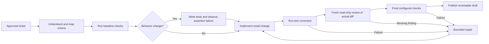

# Coding runs

Controller-managed ordinary coding runs use a worker coordinator. Each model phase
starts a fresh process with the selected provider and model. The coordinator, rather
than a model's completion claim, decides whether the next stage can run.

- Planning maps every acceptance criterion to configured checks and chooses a
  strategy: behavior TDD, regression, refactor, visual, integration, or a fast path
  limited to documentation and static styles.
- Baseline infrastructure and access failures stop the run. A regression strategy
  can retain an existing failing test baseline; final checks must still pass.
- Behavior changes require an actual assertion failure attributable to the declared
  tests. Syntax errors, missing dependencies and passing tests do not count as red.
  Implementation cannot rewrite the proven tests or their test harness to turn them
  green. The configured test command is used; project configuration controls its
  breadth.
- The independent reviewer receives the actual bounded diff, criteria, plan and
  worker check receipts, with only fixed read/search tools. It cannot change files
  or run shell commands. Blocking findings return to the builder.
- Tests, implementation, review and final-check failures share two repair attempts.
  Authentication and infrastructure failures stop rather than consuming repeated
  model repairs. The existing outer ticket recovery policy remains separate.
- Git source hashes bind checks and review to the candidate. Changed source requires
  fresh evidence before publication. Existing approval, scope, identity and delivery
  gates still apply. A published draft is not a merged or deployed change.

The private `coding-evidence.json` artifact records the selected strategy, phase
states, bounded repair count, check receipts, source hashes and review findings.
It is diagnostic evidence, not permission to resume edits in a new container.
Cross-container source resumption is not implemented.

Staging sync and promotion repair paths preserve their existing merge semantics
and checks. Their stage displays reflect the work they actually perform, without
claiming a test-first cycle. PM and worker-verification runs have their own smaller
phase sequences.

## Run overview

Mission control and Runs show the current stage, elapsed time, repair count and
stage rail on active-run cards. Expand a card for its provider, strategy and
recorded timeline inline.
Project and status filters narrow the board. Stale workers retain their last
observed phase; old runs without records show stage unavailable. There are no
invented completion percentages or estimated finish times.

Phase events are signed by the worker wrapper and bound to the run and job type.
The controller retains verified events independently of Docker availability and
the SQL activity store. Model text and browser-supplied stage metadata cannot
create a recorded stage. Private reasoning and signing material are not exposed
by the public log viewer or run cards.

## AI choices

Connect Claude Code and Codex in Connections. Choose defaults in project settings
and overrides in each PM's Product brief. A PM and its coding work can use different
providers or models from dropdown lists. Only the selected provider's current credential enters that
job. A missing connection blocks the selected route; there is no silent fallback.

The workspace default also covers new-project planning before a project exists.
See [setup instructions](SETUP.md#choose-your-ai-provider).

Catalog discovery does not run inference. Codex exposes its
[model catalog through App Server](https://learn.chatgpt.com/docs/app-server#list-models-modellist);
catalogs may be bundled and are
[not entitlement checks](https://developers.openai.com/siwc/token-sharing-open-source/codex-app-server).
Claude Code reports supported models through its pinned runtime's initialization
response; the offline fallback uses documented
[family aliases](https://code.claude.com/docs/en/model-config#model-aliases).
